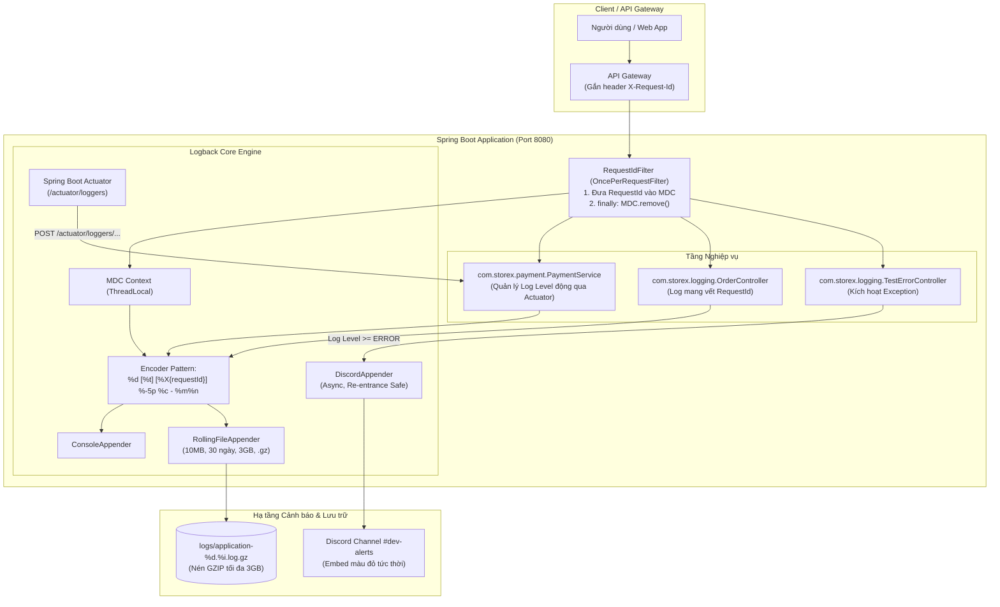

# SS18 - Quản Trị Logging Nâng Cao trong Spring Boot & Microservices

Dự án thực hành chuyên sâu về các kỹ thuật Logging hiện đại trong hệ sinh thái **Java Spring Boot, SLF4J, Logback** và môi trường phân tán: thay đổi cấp độ log động không cần restart ứng dụng (**Zero Downtime**), truy vết hành trình request xuyên suốt bằng **MDC (Mapped Diagnostic Context)**, tự động gửi cảnh báo sự cố thời gian thực qua **Custom Discord/Slack Webhook Appender**, và thiết lập cơ chế xoay vòng log (**Log Rotation**) phòng chống triệt để thảm họa tràn ổ cứng máy chủ.

---

## 📋 Cấu trúc thư mục repository `DepOpSS18`

```text
DepOpSS18/
├── bai1/
│   ├── application.yml                         ← Cấu hình expose endpoint "loggers" của Actuator
│   ├── postman_collection.json                 ← Bộ request Postman test thay đổi log level động
│   └── README.md                               ← Phân tích Dynamic Log Level qua Actuator & hướng dẫn Postman
├── bai2/
│   ├── RequestIdFilter.java                    ← OncePerRequestFilter đưa RequestId vào MDC & try-finally
│   ├── logback-spring.xml                      ← Cấu hình pattern in %X{requestId} ra console/file
│   └── README.md                               ← Phân tích ThreadLocal Memory Leak, Request Tracing & Kibana
├── bai3/
│   ├── DiscordAppender.java                    ← Custom Appender gửi HTTP POST Webhook lên Discord
│   ├── logback-spring.xml                      ← Cấu hình đăng ký DiscordAppender trong Logback
│   └── README.md                               ← Phân tích phòng chống Infinite Recursion & Non-blocking Webhook
├── bai4/
│   ├── logback-spring.xml                      ← Cấu hình RollingFileAppender 10MB, 30 ngày, totalSizeCap 3GB
│   └── README.md                               ← Phân tích sự cố VPS sập đĩa 40GB & cơ chế Log Rotation
├── storex-logging/                             ← Toàn bộ dự án Spring Boot hoàn chỉnh chạy được thực tế
│   ├── pom.xml                                 ← Cấu hình Maven dependencies (Web, Actuator, Logstash)
│   └── src/main/
│       ├── java/com/storex/
│       │   ├── payment/PaymentService.java     ← Package com.storex.payment test log DEBUG (Bài 1)
│       │   └── logging/
│       │       ├── StorexLoggingApplication.java
│       │       ├── appender/DiscordAppender.java   ← Custom Appender gửi Discord (Bài 3)
│       │       ├── controller/
│       │       │   ├── PaymentController.java      ← API test thay đổi log level (Bài 1)
│       │       │   ├── OrderController.java        ← API test MDC Request Tracing (Bài 2)
│       │       │   └── TestErrorController.java    ← API test Exception Discord & Rotation (Bài 3, 4)
│       │       └── filter/RequestIdFilter.java     ← Filter gán MDC requestId (Bài 2)
│       └── resources/
│           ├── application.yml                 ← Actuator loggers endpoint (Bài 1)
│           └── logback-spring.xml              ← Tổng hợp MDC, Discord Alert & RollingFile (Bài 2, 3, 4)
└── README.md                                   ← Báo cáo tổng hợp toàn bộ bài tập SS18
```

---

## 🎯 Tóm tắt kiến thức cốt lõi & Bẫy kỹ thuật 4 Bài tập

| Bài | Tên bài tập | Vấn đề ban đầu & Bẫy kỹ thuật | Giải pháp kỹ thuật chuẩn hóa |
|---|---|---|---|
| **Bài 1** | **Thay đổi Log Level không cần Restart** | **Bẫy Ẩn Endpoint:** `application.yml` chỉ include `health,info`, khiến endpoint `/actuator/loggers` trả về HTTP 404. Phải restart app để đổi log $\rightarrow$ gây downtime dịch vụ trên Production. | Thêm `loggers` vào `management.endpoints.web.exposure.include`. Gửi request `POST /actuator/loggers/com.storex.payment` với body `{"configuredLevel": "DEBUG"}`. Cập nhật log level trực tiếp trong RAM trong vài mili-giây mà không restart. |
| **Bài 2** | **Theo vết Request với MDC (Mapped Diagnostic Context)** | **Bẫy ThreadLocal Memory Leak & Value Bleed:** Sinh UUID nhưng quên gọi `MDC.put()`. Nếu put mà quên khối `finally { MDC.remove() }`, Tomcat worker thread sẽ mang `requestId` của user cũ sang request mới, gây lẫn lộn dữ liệu và rò rỉ bộ nhớ. | Viết `RequestIdFilter` kế thừa `OncePerRequestFilter`: nhận `X-Request-Id` từ header hoặc sinh UUID, đưa vào `MDC.put("requestId", ...)`, gắn vào response header và **bắt buộc dọn dẹp trong `finally`**. Cấu hình `%X{requestId}` trong `logback-spring.xml`. |
| **Bài 3** | **[Custom Appender] Bắn cảnh báo ERROR lên Discord/Slack** | **Bẫy Đệ quy vô tận & Nghẽn luồng:** Nếu gọi webhook thất bại mà dùng `log.error()`, chính appender sẽ bị gọi lại vô hạn $\rightarrow$ `StackOverflowError` làm chết JVM. Ngoài ra, gọi HTTP đồng bộ làm luồng Tomcat bị delay 1-2s. | Kế thừa `AppenderBase<ILoggingEvent>`, sử dụng cờ an toàn `ThreadLocal<Boolean> isSending` chống đệ quy. Gửi HTTP POST bất đồng bộ (`sendAsync`) bằng Java 11 `HttpClient` với ThreadPool riêng. Format Embed Discord màu đỏ (`#E74C3C`), trích xuất `requestId` và StackTrace. |
| **Bài 4** | **Phân tích và khắc phục Log Rotation (Ổ cứng đầy)** | **Bẫy `FileAppender` gây đầy ổ cứng 40GB:** `FileAppender` ghi nối tiếp vào 1 file tĩnh duy nhất, không nén, không xoay vòng, không xóa log cũ $\rightarrow$ Ổ cứng VPS đầy 100% (`ENOSPC`), MySQL crash, hệ điều hành tê liệt. | Thay thế bằng `RollingFileAppender` kết hợp `SizeAndTimeBasedRollingPolicy`: xoay vòng theo ngày `%d{yyyy-MM-dd}`, mỗi file tối đa **10MB** (`maxFileSize`), nén **GZIP (`.gz`)** giảm 90% dung lượng, tự động xóa log sau **30 ngày** (`maxHistory`), chốt chặn **3GB** (`totalSizeCap`). |

---

## 🏗️ Kiến trúc Tổng thể Hệ thống Logging StoreX



---

## 🚀 Hướng dẫn Chạy & Kiểm thử Thực tế

### 1. Khởi động ứng dụng Spring Boot
```bash
cd storex-logging
mvn spring-boot:run
```
Ứng dụng sẽ lắng nghe tại cổng `http://localhost:8080`.

---

### 2. Kiểm thử Bài 1: Đổi Log Level động (Dynamic Log Level)
```bash
# A. Kiểm tra level ban đầu của com.storex.payment (kết quả: INFO)
curl -X GET http://localhost:8080/actuator/loggers/com.storex.payment

# B. Đổi log level sang DEBUG (không cần restart)
curl -X POST http://localhost:8080/actuator/loggers/com.storex.payment \
     -H "Content-Type: application/json" \
     -d '{"configuredLevel": "DEBUG"}'

# C. Gọi API thanh toán để kiểm tra log DEBUG xuất hiện
curl -X POST http://localhost:8080/api/payment/process \
     -H "Content-Type: application/json" \
     -d '{"orderId":"ORD-1122","amount":250000}'

# D. Khôi phục lại về INFO sau khi kiểm tra xong
curl -X POST http://localhost:8080/actuator/loggers/com.storex.payment \
     -H "Content-Type: application/json" \
     -d '{"configuredLevel": "INFO"}'
```

---

### 3. Kiểm thử Bài 2: Theo vết Request với MDC
```bash
# Gửi 1 request checkout
curl -i -X POST http://localhost:8080/api/orders/checkout \
     -H "Content-Type: application/json" \
     -d '{"item":"iPhone 15 Pro Max"}'
```
Quan sát terminal:
```text
2026-11-08 22:55:00.100 [http-nio-8080-exec-1] [f8a7b6c5-4d3e-2f10-abcd-1234567890ab] INFO  c.s.l.c.OrderController - Bước 1: Tiếp nhận yêu cầu tạo đơn hàng từ Client
2026-11-08 22:55:00.105 [http-nio-8080-exec-1] [f8a7b6c5-4d3e-2f10-abcd-1234567890ab] INFO  c.s.l.c.OrderController - Bước 2: Kiểm tra tồn kho cho danh sách sản phẩm: iPhone 15 Pro Max
2026-11-08 22:55:00.110 [http-nio-8080-exec-1] [f8a7b6c5-4d3e-2f10-abcd-1234567890ab] INFO  c.s.l.c.OrderController - Bước 3: Tạm khóa số lượng hàng tồn và áp dụng mã giảm giá
```
Mọi dòng log đều có chung mã UUID `[f8a7b6c5-4d3e-2f10-abcd-1234567890ab]`.

---

### 4. Kiểm thử Bài 3: Bắn Cảnh báo ERROR lên Discord
```bash
# Thiết lập Webhook URL thật của bạn (hoặc để mặc định)
export DISCORD_WEBHOOK_URL="https://discord.com/api/webhooks/YOUR_WEBHOOK_ID/YOUR_WEBHOOK_TOKEN"

# Gọi API kích hoạt lỗi SQLException
curl -X GET http://localhost:8080/api/test/error-db
```
Ngay lập tức, kênh Discord nhận được Embed thông báo màu đỏ rực kèm đầy đủ `Application`, `Request ID (MDC)`, `Logger`, và `Stack Trace`.

---

### 5. Kiểm thử Bài 4: Kiểm tra Log Rotation chống đầy đĩa
```bash
# Sinh 50.000 dòng log giả lập dữ liệu lớn
curl -X GET "http://localhost:8080/api/test/generate-logs?count=50000"

# Kiểm tra thư mục logs/
ls -lh logs/
```
Log tự động được cắt thành các file `application-%d{yyyy-MM-dd}.%i.log.gz` không vượt quá 10MB và được nén GZIP gọn gàng.

---

## 📤 Hướng dẫn nộp bài lên GitHub

Toàn bộ mã nguồn bài tập SS18 đã được cấu hình và đẩy lên repository GitHub độc lập:

- **Repository URL:** **[https://github.com/ceil891/DepOpSS18](https://github.com/ceil891/DepOpSS18)**

Các lệnh quản trị Git:
```bash
# 1. Kiểm tra trạng thái tệp
git status

# 2. Thêm tất cả thay đổi vào staging
git add .

# 3. Commit thay đổi
git commit -m "feat(ss18): hoan thanh 4 bai tap dynamic log level, mdc tracing, custom discord appender va log rotation"

# 4. Đẩy mã nguồn lên GitHub
git push origin main
```

Sau khi hoàn tất, bạn chỉ cần sao chép liên kết **[https://github.com/ceil891/DepOpSS18](https://github.com/ceil891/DepOpSS18)** và dán vào form nộp bài trên Portal.
