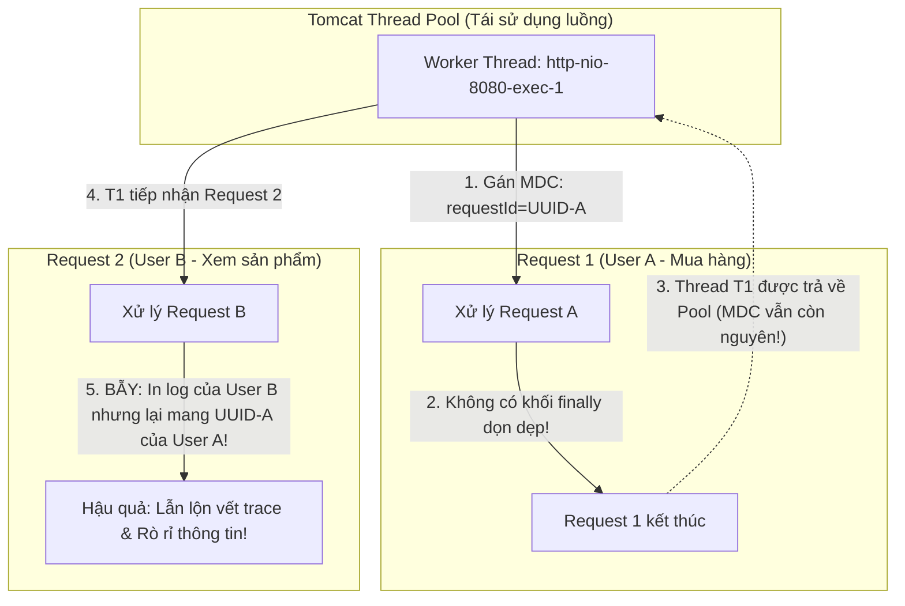

# Bài tập 2: Theo vết Request với MDC (Mapped Diagnostic Context) - Request Tracing Architecture

## 1. Mục tiêu kiến thức
- Hiểu rõ nguyên lý hoạt động của **Mapped Diagnostic Context (MDC)** trong thư viện **SLF4J/Logback**.
- Nắm vững kiến trúc quản lý ngữ cảnh luồng (**ThreadLocal**) trong Java Web Containers (Spring Boot / Tomcat).
- Biết cách xây dựng Filter chặn đầu vào (`OncePerRequestFilter`) để tự động gán hoặc tiếp nhận `requestId` / `traceId`.
- Định cấu hình mẫu in ấn (`pattern`) trong `logback-spring.xml` sử dụng cú pháp `%X{key}`.
- Hiểu và phòng tránh triệt để hiểm họa rò rỉ bộ nhớ (**ThreadLocal Memory Leak**) và lẫn lộn dữ liệu ngữ cảnh (**Context/Value Bleed**).

---

## 2. Tình huống nghiệp vụ & Bẫy kỹ thuật

### 2.1. Tình huống
Hệ thống E-Commerce StoreX phục vụ hàng nghìn giao dịch mỗi phút. Trên Kibana, log của hàng trăm luồng xử lý đồng thời (`http-nio-8080-exec-1`, `exec-2`, `exec-3`...) bị ghi xen kẽ (interleaving) tạo thành một mớ hỗn độn.
Khi khách hàng báo lỗi: *"Tôi bấm thanh toán thì bị trừ tiền nhưng web báo thất bại"*:
- Dev lên Kibana tìm thấy dòng: `ERROR c.s.payment.PaymentService - Transaction failed`.
- Nhưng không thể biết dòng lỗi này thuộc về đơn hàng nào, của User nào, và luồng sự kiện trước đó (Giỏ hàng gồm những gì, mã voucher áp dụng, thông điệp phản hồi từ cổng thanh toán) đã diễn ra ra sao vì **hoàn toàn không có định danh duy nhất (TraceId / RequestId)** liên kết toàn bộ vòng đời của request đó!

Đoạn mã ban đầu bị lỗi:
```java
// CODE BAN ĐẦU BỊ LỖI
@Component
public class RequestIdFilter extends OncePerRequestFilter {
    @Override
    protected void doFilterInternal(HttpServletRequest request, HttpServletResponse response, FilterChain filterChain) {
        // LỖI: Sinh UUID ngẫu nhiên nhưng để biến cục bộ, quên đưa vào MDC context của Logback!
        String requestId = UUID.randomUUID().toString();
        
        filterChain.doFilter(request, response);
    }
}
```

---

### 2.2. Bẫy kỹ thuật kinh điển: ThreadLocal Memory Leak & Value Bleed

MDC hoạt động dựa trên cơ chế **`ThreadLocal`**: mỗi luồng (`Thread`) sở hữu một bản đồ (Map) riêng trong bộ nhớ để lưu trữ các cặp key-value.



#### Hai hiểm họa nếu thiếu khối `try-finally`:
1. **Lẫn lộn vết vết truy vết (Context / Value Bleed):**
   - Luồng Tomcat không bị hủy khi request kết thúc mà được trả về **Thread Pool**.
   - Khi một khách hàng khác (User B) gửi request mới và tình cờ được phân bổ vào đúng thread vừa dùng xong của User A, nếu MDC chưa bị xóa, mọi dòng log của User B sẽ mang mã `requestId` của User A!
   - Điều này làm sai lệch toàn bộ dữ liệu điều tra sự cố và vi phạm an toàn thông tin.
2. **Rò rỉ bộ nhớ (Memory Leak):**
   - Biến `ThreadLocal` giữ tham chiếu mạnh tới các đối tượng trong Map. Nếu ứng dụng chạy nhiều ngày với hàng triệu request, các thread trong pool không được giải phóng bộ nhớ sẽ dẫn tới lỗi **`java.lang.OutOfMemoryError: Metaspace`** hoặc Heap Dump phình to.

---

## 3. Giải pháp kỹ thuật chuẩn hóa

### 3.1. Code `RequestIdFilter.java` chuẩn mực
- Tiếp nhận header `X-Request-Id` nếu có (từ API Gateway hoặc Microservice phía trước) để duy trì **Distributed Tracing**.
- Đưa vào `MDC.put("requestId", requestId)`.
- Gắn vào Response Header để trả về cho Client.
- **Bắt buộc** dùng `try-finally` để gọi `MDC.remove(...)` hoặc `MDC.clear()`.

```java
package com.storex.logging.filter;

import org.slf4j.MDC;
import org.springframework.core.Ordered;
import org.springframework.core.annotation.Order;
import org.springframework.stereotype.Component;
import org.springframework.util.StringUtils;
import org.springframework.web.filter.OncePerRequestFilter;

import javax.servlet.FilterChain;
import javax.servlet.ServletException;
import javax.servlet.http.HttpServletRequest;
import javax.servlet.http.HttpServletResponse;
import java.io.IOException;
import java.util.UUID;

@Component
@Order(Ordered.HIGHEST_PRECEDENCE)
public class RequestIdFilter extends OncePerRequestFilter {

    public static final String MDC_KEY_REQUEST_ID = "requestId";
    public static final String HEADER_REQUEST_ID = "X-Request-Id";

    @Override
    protected void doFilterInternal(HttpServletRequest request,
                                    HttpServletResponse response,
                                    FilterChain filterChain) throws ServletException, IOException {

        // 1. Kế thừa Request ID từ Gateway nếu có, nếu chưa có thì sinh mới
        String requestId = request.getHeader(HEADER_REQUEST_ID);
        if (!StringUtils.hasText(requestId)) {
            requestId = UUID.randomUUID().toString();
        }

        try {
            // 2. Put vào MDC để Logback tự động tiêm vào mọi dòng log
            MDC.put(MDC_KEY_REQUEST_ID, requestId);

            // 3. Trả về Response Header cho Client
            response.setHeader(HEADER_REQUEST_ID, requestId);

            // 4. Chuyển tiếp vào chuỗi Filter
            filterChain.doFilter(request, response);

        } finally {
            // 5. GIẢI PHÁP TRIỆT TIÊU MEMORY LEAK: Dọn dẹp MDC ngay khi luồng xử lý xong
            MDC.remove(MDC_KEY_REQUEST_ID);
        }
    }
}
```

### 3.2. Cấu hình `logback-spring.xml`
Sử dụng chỉ thị **`%X{requestId}`** trong Pattern Layout:

```xml
<property name="LOG_PATTERN"
          value="%d{yyyy-MM-dd HH:mm:ss.SSS} [%thread] [%X{requestId:-SYSTEM}] %-5level %logger{36} - %msg%n" />

<appender name="CONSOLE" class="ch.qos.logback.core.ConsoleAppender">
    <encoder>
        <pattern>${LOG_PATTERN}</pattern>
    </encoder>
</appender>
```
*(Nếu request chạy ngầm từ cronjob hoặc startup hệ thống không qua HTTP Filter, cú pháp `:-SYSTEM` sẽ in chữ `[SYSTEM]` thay vì để trống).*

---

## 4. Hướng dẫn kiểm thử & Xác thực kết quả

### Bước 1: Gửi request thử nghiệm
Gửi request tạo đơn hàng:
```bash
curl -i -X POST http://localhost:8080/api/orders/checkout \
     -H "Content-Type: application/json" \
     -d '{"userId":1001,"item":"Laptop Dell XPS","amount":35000000}'
```

**Quan sát Response Header:**
```http
HTTP/1.1 200 OK
X-Request-Id: 9f8e7d6c-5b4a-3210-fedc-ba9876543210
Content-Type: application/json
```

---

### Bước 2: Quan sát Log xuất hiện trên Console / File Log
Dù các dòng log được in ra từ nhiều class khác nhau (`OrderController`, `OrderService`, `PaymentService`, `InventoryService`), tất cả đều sở hữu chung một mã `requestId`:

```text
2026-11-08 22:52:10.100 [exec-1] [9f8e7d6c-5b4a-3210-fedc-ba9876543210] INFO  c.s.c.OrderController - Received checkout request for user 1001
2026-11-08 22:52:10.115 [exec-1] [9f8e7d6c-5b4a-3210-fedc-ba9876543210] INFO  c.s.s.OrderService - Checking stock for item: Laptop Dell XPS
2026-11-08 22:52:10.130 [exec-1] [9f8e7d6c-5b4a-3210-fedc-ba9876543210] INFO  c.s.s.InventoryService - Inventory reserved successfully
2026-11-08 22:52:10.150 [exec-1] [9f8e7d6c-5b4a-3210-fedc-ba9876543210] ERROR c.s.p.PaymentService - Transaction failed: Insufficient bank balance
```

---

### Bước 3: Tìm kiếm trên Kibana
Khi khách hàng gửi mã lỗi `9f8e7d6c-5b4a-3210-fedc-ba9876543210`:
- Kỹ sư chỉ cần gõ vào ô tìm kiếm của Kibana:
  ```text
  requestId: "9f8e7d6c-5b4a-3210-fedc-ba9876543210"
  ```
- **Kết quả:** Kibana lọc ra chính xác 100% toàn bộ chuỗi 4 dòng log của giao dịch đó theo đúng thứ tự thời gian, loại bỏ hoàn toàn hàng triệu dòng log rác của các user khác xung quanh!

---

## 5. Kết luận rút ra
- MDC là viên gạch nền móng cho khả năng quan sát hệ thống (**Observability**) và phân tích nguyên nhân gốc rễ (**Root Cause Analysis**).
- Luôn luôn đặt việc dọn dẹp MDC trong khối **`finally`** để bảo vệ Thread Pool và tính toàn vẹn của dữ liệu.
